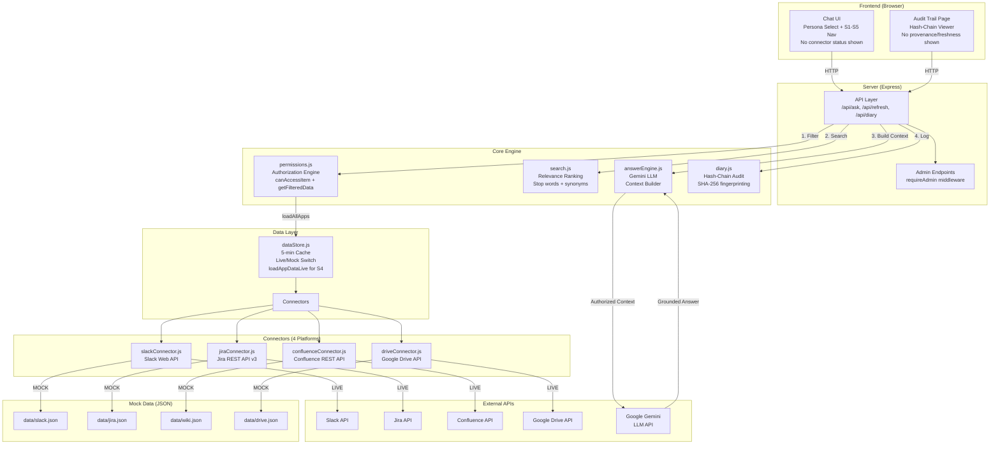
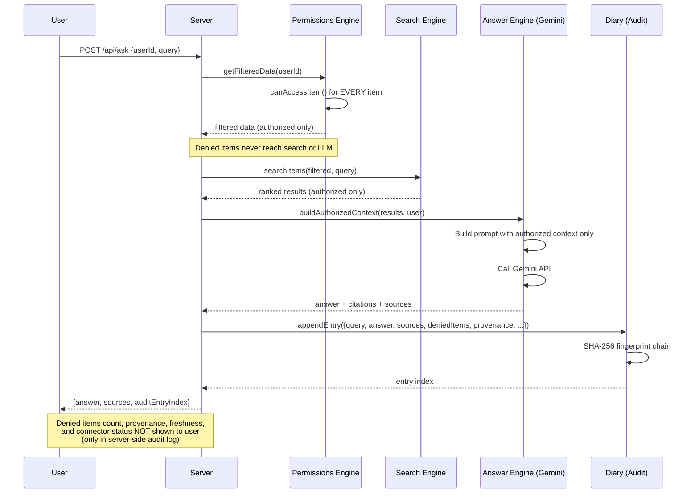
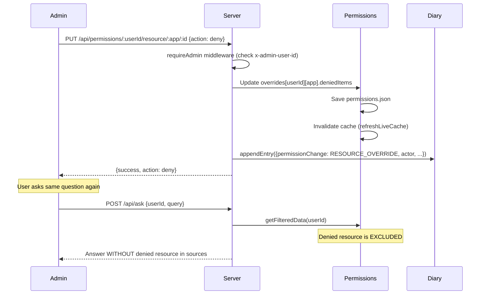
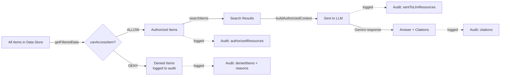
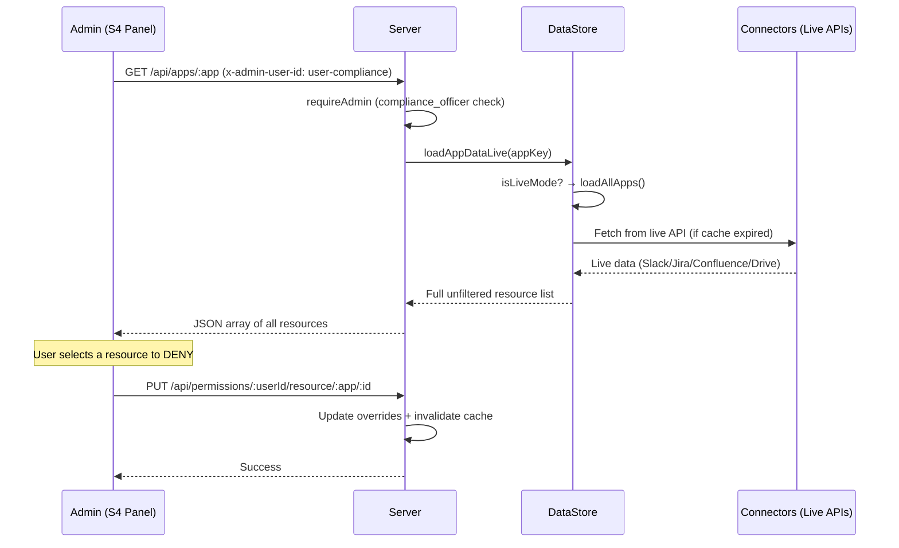

# Internal Brain — Architecture Diagram

## System Architecture (Mermaid)

## Permission Flow (Mermaid)

## S4 Permission Change Flow (Mermaid)

## Three-Tier Resource Tracking

## S4 Resource Dropdown Data Flow (Mermaid)

